# RouteBox - An End-to-End Dual-Agent–Driven Sandbox for Network Security Evaluation

## Table of Contents

- [RouteBox Overview](#routebox-overview)
- [Repository Architecture](#repository-architecture)
- [Quick Start](#quick-start)
- [Usage Guide](#usage-guide)

## RouteBox Overview

RouteBox is a comprehensive network emulation and evaluation platform designed to address critical challenges in Internet network system security. It enables custom topology construction, controlled attack injection, accurate and efficient anomaly detection, interpretable root cause analysis, multi-modal telemetry collection, and anomaly dataset construction, providing network operators and researchers a reproducible environment to study network faults, attacks, and resilience.

<div align=center>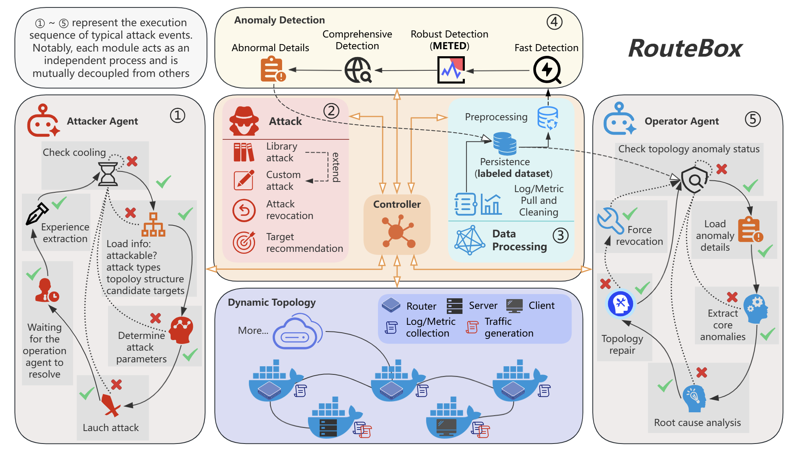</div>

The figure above illustrates the core modules of RouteBox and the data flow between them. Each module collaborates to realize an end-to-end automated workflow, covering network environment emulation, attack injection, anomaly detection, and root-cause analysis.

1. Dynamic Topology: Leveraging the SERNES substrate and [customizable traffic scripts](src/topology/util/templates/host/traffic_service.py), combined with a multi-source log collection system, it achieves high-fidelity emulation and dynamic synchronization of large-scale network topologies, while supporting third-party application deployment and backbone network traffic simulation.
2. [Attack Library](src/core-framework/src/main/java/com/routebox/manager/attack/AttackHandler.java): Implements an extensible built-in attack library, covering 10 attack types across routing, node, and link layers. It supports one-click attack initiation and revocation, ensuring attack controllability through API-driven automation and state recovery mechanisms.
3. [Target Recommendation](src/core-framework/src/main/java/com/routebox/manager/RecommendManager.java): Based on the basic BGP routing principles (shortest path) and the characteristics of network topology, we provide a practical target recommendation module that considers AS hop count, node centrality, and path importance.
4. [Log Processing](src/core-framework/src/main/java/com/routebox/manager/LogManager.java): Constructs a highly available unified log processing pipeline, completing the full workflow of multi-source log retrieval, cleaning, structured conversion, and Elasticsearch storage to provide comprehensive data support for subsequent analysis.
5. [Interaction Controller](src/core-framework/src/main/java/com/routebox/manager/InteractionManager.java): Serves as the communication bridge between other decoupled modules, responsible for obtaining topology configurations and state updates, executing node commands, and supporting cross-module interactions such as container access.
6. [Data Processing](src/core-framework/src/main/java/com/routebox/manager/DatasetManager.java): Retrieves raw data from the database, performs cleaning, time-window alignment, and metric aggregation, then transmits standardized data to the Anomaly Detection Module to ensure the reliability of detection data.
7. [Anomaly Detection](src/anomaly-detection/algorithm/meted.py): Provides the implementation of the METED algorithm (Median-based Efficient Time-series Event Detector), which is tailored for network data.
8. [Attacker Agent](src/agents/attack-agent/graph/workflow.py): Leverages the powerful capabilities of large models, we construct the future-oriented intelligent attacker agent, whose approximate workflow is: cooling -> attack decision -> attack injection -> topology state monitoring -> experience summarization -> cooling.
9. [Operator Agent](src/agents/operation-agent/graph/workflow.py): We construct the future-oriented intelligent operator agent, whose approximate workflow is: topology state monitoring -> anomaly details parsing -> root cause analysis -> topology repair -> topology state monitoring. Although the current version is still far from our ultimate goal of fully automated topology repair, we have already established the basic framework. We believe that achieving that goal is only a matter of time.

## Repository Architecture

```
RouteBox/
├── docs/ # documentation
├── docker/ # docker deployment resources
├── src/ # source code
│   ├── scripts/ # auxiliary scripts, e.g., schedule attack injection
│   ├── topology/ # topology construction scripts and configuration files
│   ├── anomaly-detection/ # anomaly detection service
│   ├── core-framework/ # core framework of RouteBox
│   ├── agents/ # attacker and operator agents
│   └── visualization/ # visualization frontend
└── dataset/ # open-Source Data
    ├── LLM_diagnose/
    ├── system_network_anomaly_detection/
    ├── bgp_updates/
    └── multi_modal_data/
```

**Import links**

1. [documentation of datasets](docs/dataset.md)
2. [documentation of topology](docs/topology.md)

## Quick Start

### Prerequisites (SERNES Service)

RouteBox is built on SERNES, a free cloud emulation platform for large-scale network research that has been adopted by over 40 academic institutions and organizations worldwide. To use RouteBox, you must first complete the following preparations (For detailed tutorials, please refer to [topology.md](docs/topology.md)):

1. **Register for a SERNES Account**: Access the [official website of SERNES](https://www.sernes.cn/) and complete the account registration process.
2. **Obtain SERNES ID**: After successfully registering and applying for a trial of SERNES, you will be assigned a unique `SERNES_ID` and gain access to a backend management page with a URL format similar to `https://<Your SERNES_ID>.frontend.sernes.cn/realsAdmin/#/reals/network`. The `<Your SERNES_ID>` placeholder must be configured into RouteBox's system configuration file—specific operation steps are detailed in the subsequent **Deployment** chapter.
3. **Upload a Topology Directory**: Before starting RouteBox, you need to upload a topology directory (in ZIP format) via the SERNES management page.
   - For quick testing: We provide two pre-built topology `network_100_2.0.zip` and `network_route_leakage.zip` in the `src/topology/network/` directory. This topology, used in our core experiments, includes 50 AS nodes and 50 corresponding Host nodes. To use them, upload the ZIP file to the SERNES management page and start the topology.

### Recommended Hardware Configuration

| Component    | Minimum Requirement | Recommended Configuration |
| ------------ | ------------------- | ------------------------- |
| CPU          | 6 cores             | 8 cores+                  |
| Memory       | 8 GB RAM            | 16 GB RAM+                |
| Disk Storage | 256 GB SSD          | 512 GB SSD+               |

### Docker Deployment

#### Docker Environment Check

Before deployment, ensure that Docker (20.10+) and Docker Compose (2.0+) are installed on your system. You can verify the installation by running the following commands:

```bash
docker -v
docker-compose -v
```

#### Necessary Configuration (In /docker directory)

1. Core Framework [application-dev.yaml](docker/core-framework/application-dev.yaml)

```yaml
topology:
  sernes-id: xxx # Replace with your actual SERNES ID (https://<Your SERNES ID>.frontend.sernes.cn/realsAdmin/#/reals/network)
```

2. Attacker Agent [.env](docker/attacker-agent/.env)

```python
BASE_URL = "YOUR_LLM_BASE_URL" # e.g., "https://api.openai.com/v1"
API_KEY = "YOUR_LLM_API_KEY"   # e.g., "sk-xxxxxxxxxxxxxxxxxxxxxxxxxxxxxxxx"
API_MODEL = "YOUR_LLM_MODEL"   # e.g., "gpt-3.5-turbo"
```

3. Operator Agent [.env](docker/operator-agent/.env)

```python
BASE_URL = "YOUR_LLM_BASE_URL" # e.g., "https://api.openai.com/v1"
API_KEY = "YOUR_LLM_API_KEY"   # e.g., "sk-xxxxxxxxxxxxxxxxxxxxxxxxxxxxxxxx"
API_MODEL = "YOUR_LLM_MODEL"   # e.g., "gpt-3.5-turbo"
```

#### Build and Start Services

```bash
# Enter docker directory
cd docker

# Build and start all services
docker-compose up -d --build

# Build all images
# docker compose build --no-cache
# Start all services
# docker compose up -d

# Check service status
docker compose ps
```

For more detailed image information and customized Docker process startup, please refer to [docker-compose.yaml](docker/docker-compose.yaml).

#### Default Service

| Module                     | Port             | Username | Password |
| -------------------------- | ---------------- | -------- | -------- |
| routebox-visualization     | 80               | \\       | \\       |
| routebox-attacker-agent    | 4399 (WebSocket) | \\       | \\       |
| routebox-operator-agent    | 4400 (WebSocket) | \\       | \\       |
| routebox-core-framework    | 12100            | \\       | \\       |
| routebox-anomaly-detection | 12101            | \\       | \\       |
| routebox-elasticsearch     | 12102            | elastic  | routebox |
| routebox-grafana           | 12103            | admin    | routebox |

#### Check Deployment Status

Enter the following links in the browser to check the health status of each service:

1. routebox-visualization: Access `http://YOUR_DOCKER_HOST`, simply verify whether the RouteBox system is activated.
2. routebox-core-framework: Access `http://YOUR_DOCKER_HOST:12100/actuator/health`, normal if the response is `{"status":"UP"}`.
3. routebox-anomaly-detection: Access `http://YOUR_DOCKER_HOST:12101/health`, normal if the response is `{"status":"UP"}`.
4. routebox-elasticsearch: Access `"http://YOUR_DOCKER_HOST:12102/_cluster/health"` (Require login with `elastic` and `routebox`), normal if the response is `{"cluster_name":"docker-cluster","status":"yellow",...}`.
5. routebox-grafana: Access `http://YOUR_DOCKER_HOST:12103/api/health`, normal if the response is `{"database": "ok",...}`.

For the attacker agent and operator agent processes, please verify them inside the container through `docker exec -it routebox-attacker-agent` and `docker exec -it routebox-operator-agent`.

#### Stop/Restart Services

```bash
# Stop all services
docker compose down

# Stop and delete data volumes (CAUTION: will clear Elasticsearch and Grafana data)
docker compose down -v

# Restart services
docker compose restart
```

## Usage Guide

### Home Page

<div align=center>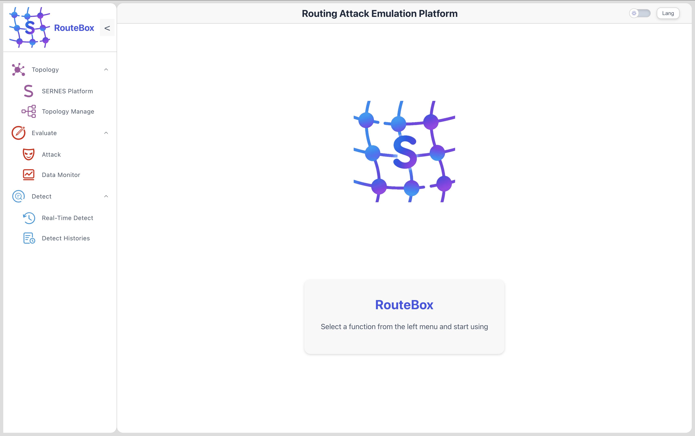</div>

This is the homepage of the RouteBox Network Attack Emulation Platform.

### Topology Module

#### SERNES Platform

<div align=center>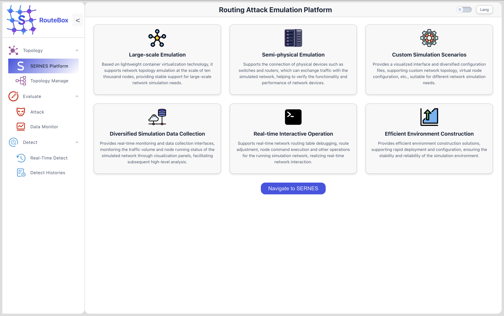</div>

#### Topology Manage

The `Topology manage` page can be used to view the core information of the running network topology.

<div align=center>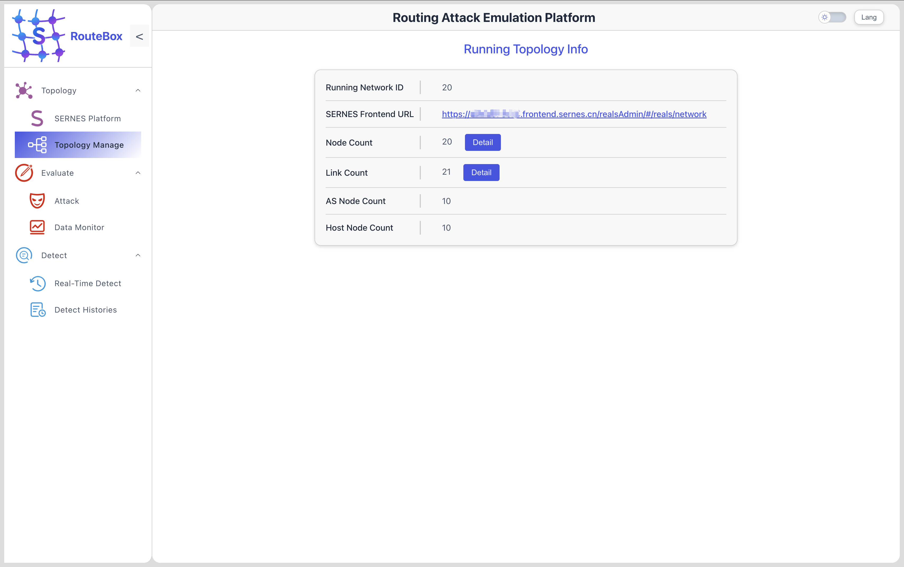</div>

Click the `Detail` button next to `Node Count` and `Link Count` respectively to view detailed node and link information in the running topology

<div align=center>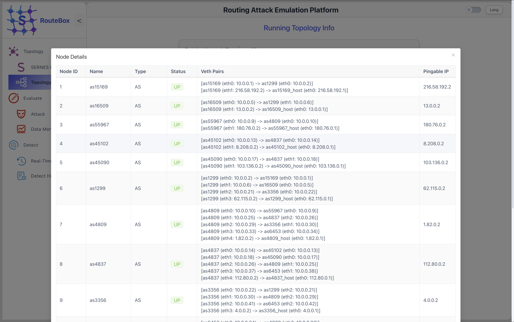</div>
<div align=center>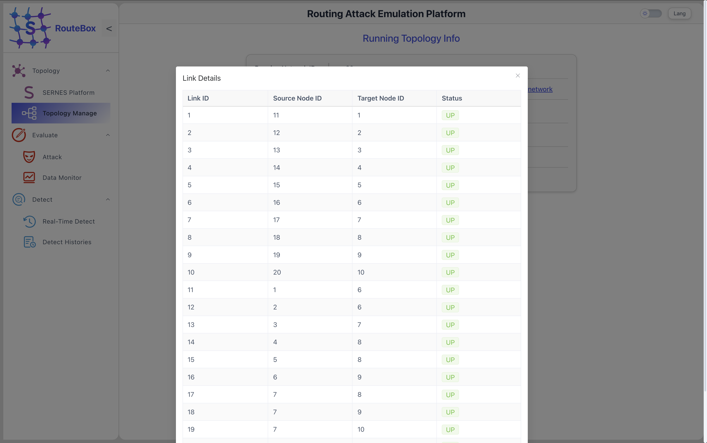</div>

### Evaluate Module

#### Attack

You can easily launch or revoke the 10 attack methods currently supported within RouteBox on this page and get recommendations (click the `yellow light` icon). Meanwhile, the table below will record historical attack records.

<div align=center>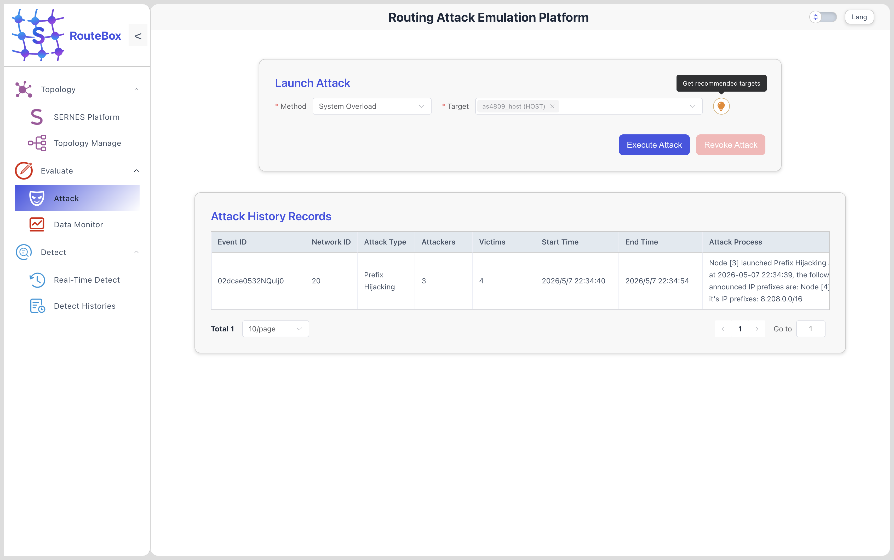</div>

#### Data Monitor

Click the `Visit My Dashboard` button and jump to the embedded Grafana dashboard.

<div align=center>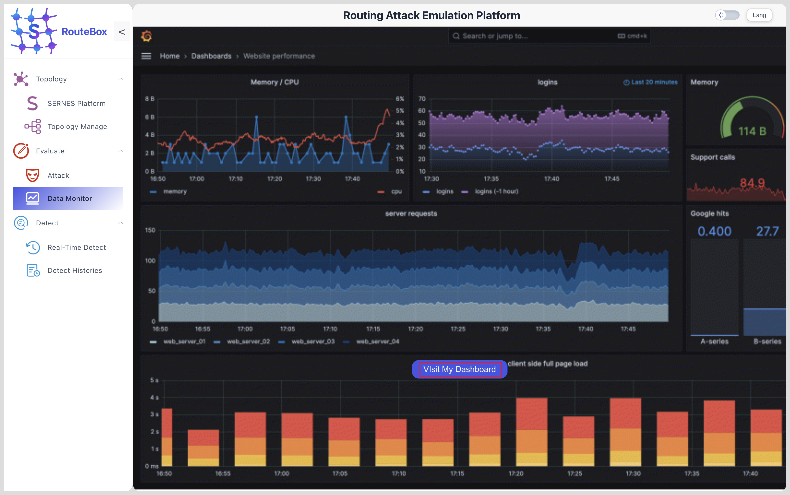</div>

<div align=center>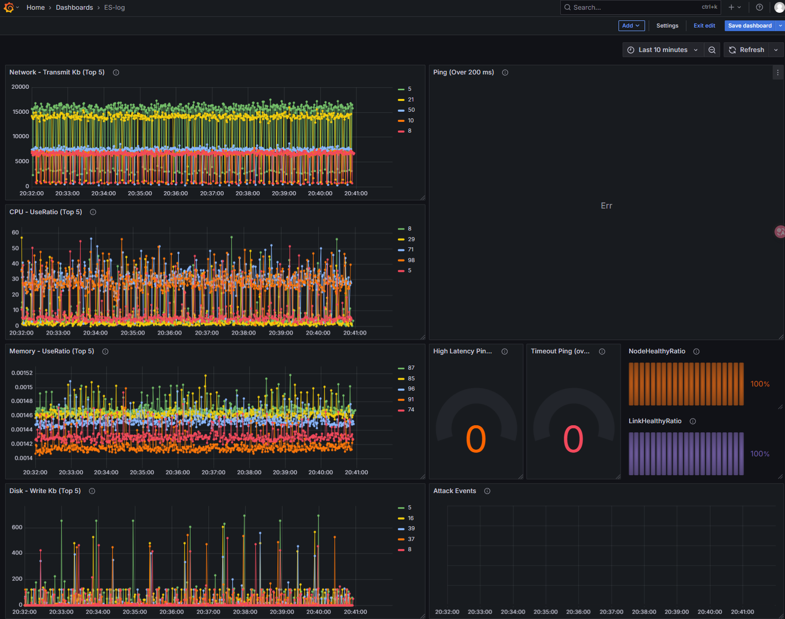</div>

### Detect Module

#### Real-Time Detection

The centric-controller (i.e, the core-framework) automatically starts anomaly detection every minute by default, with a window range of \[now - 31min, now - 1min]. Delay of 1 minute is to ensure that the log is complete (if pulling the log of \[now-30min, now], it cannot guarantee that the log of `now` has been successfully stored in the database). Meanwhile, since the anomaly detection module requires data to be periodic and have normal logs, the true detection process will only be initiated when there is at least one week of log volume in the database (the default log cycle is 7 days, but you can manually modify the traffic script to change the periodicity, refer to [topology documentation](docs/topology.md)). Otherwise, the detection will end quickly as shown in the figure.

<div align=center>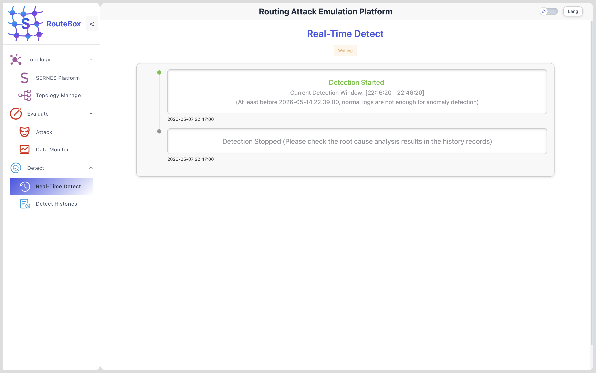</div>

#### Detect Histories

The `Detect Histories` module records all detection records that have undergone complete anomaly detection (i.e. detection after at least one week of log volume)

<div align=center>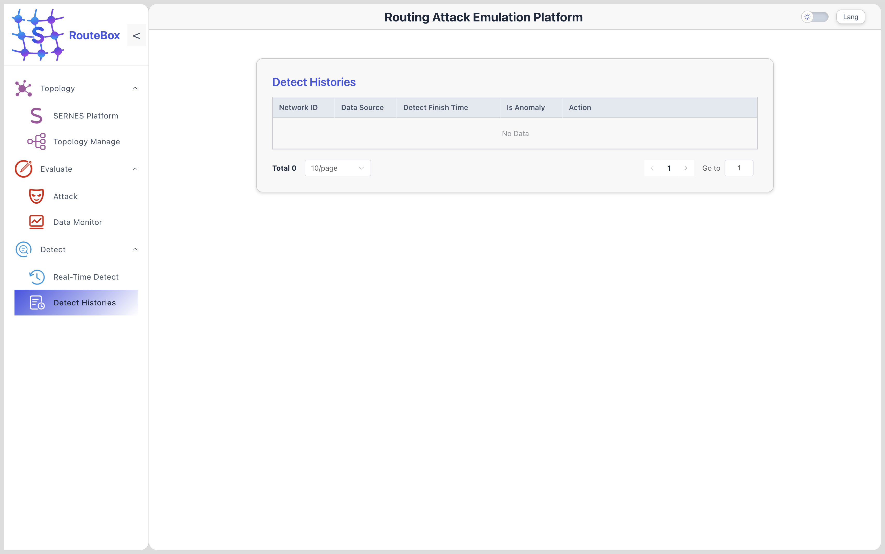</div>
