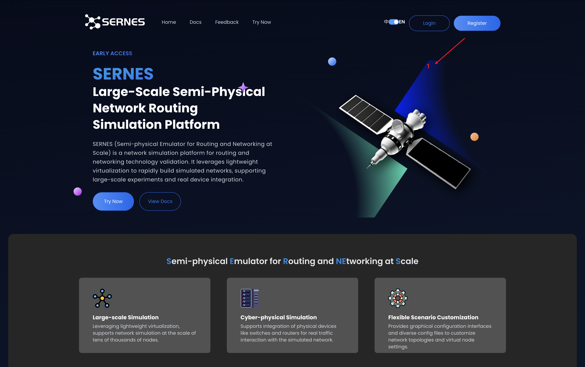
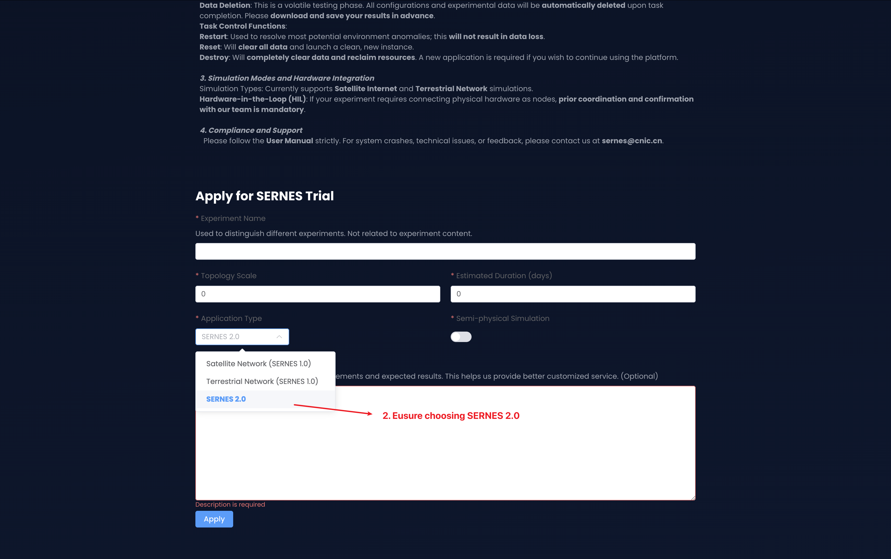
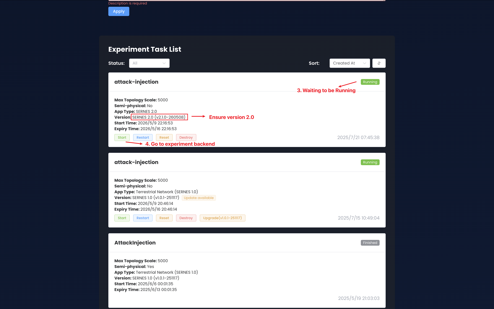
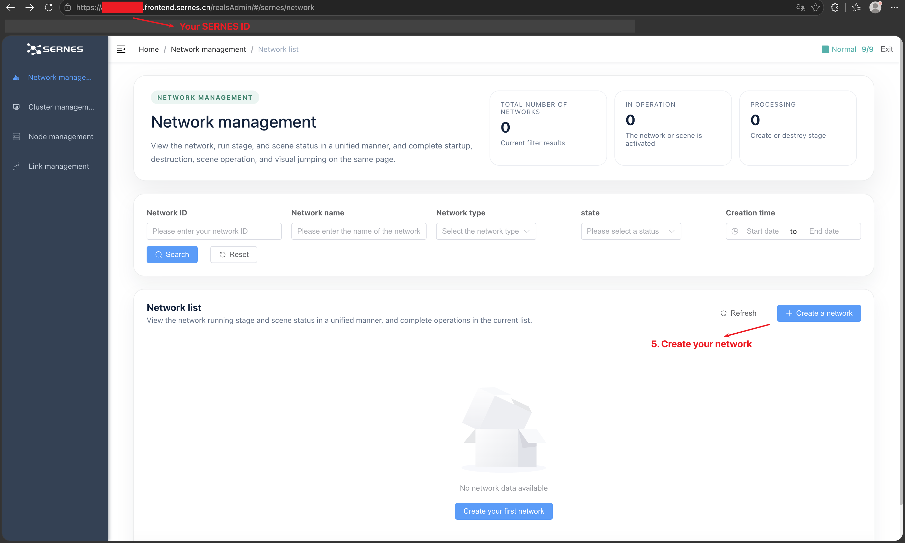
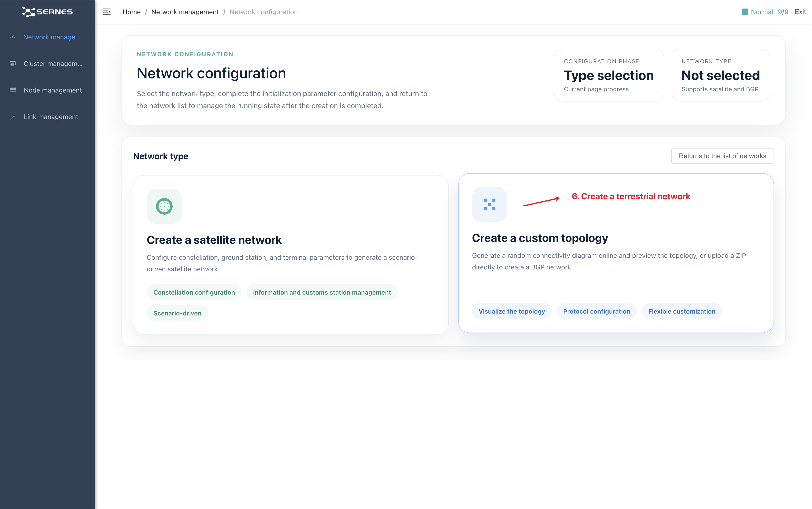
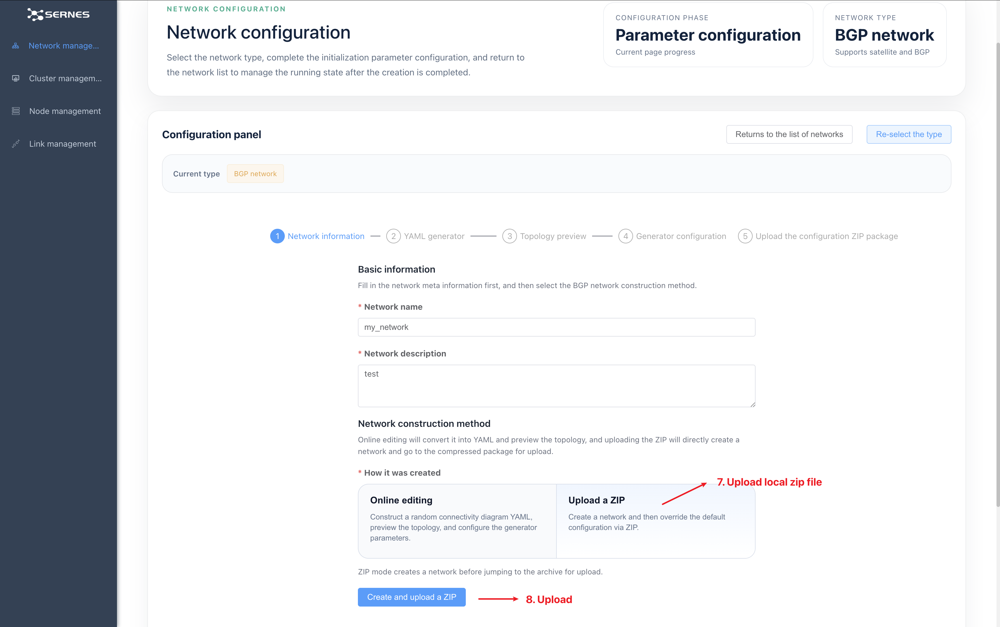
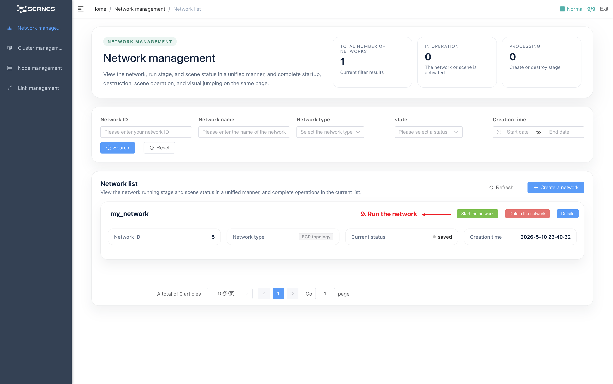

# Topology Module

## SERNES Access

1. Access the [SERNES official website](https://www.sernes.cn/).
2. Register an account.
   <div align=center></div>
3. Apply for trial access.
   <div align=center></div>
4. Wait for approval, then enter the SERNES backend page.
   <div align=center></div>
5. Obtain your SERNES ID on the Topology Management page.
   <div align=center></div>
6. Prepare the topology zip package:
   - Create topology files via [Topology Util](#topology-util), and then package these files (do NOT include the parent directory like `network_100_2.0` itself) into a zip,
   - Or just use zip files under `src/topology/network/`.

7. Click the **Create a network** button to upload the zip package, then apply the uploaded topology.
   <div align=center></div>
   <div align=center></div>
8. Run the uploaded topology.
   <div align=center></div>

## Topology Util

We provide a convenient way for users to quickly build a specified structural topology in the `src/topology/util/` directory. Topology files created through this tool have the following features:

1. Contains 2n nodes, where n are interconnected AS nodes and the other n are Host nodes, each connected to an AS node.
2. Already a complete directory structure, contains 2n node file directories (determining the nature of nodes, log-related scripts, traffic-related scripts, etc.) and a configured `config.yaml` file (including system images used by nodes, start/end commands of nodes, resource volumes, node network configuration, link configuration between links, etc.). After compressing all those files (exclude the parent directory such as `network_100.2.0`) into a zip file, they can be directly uploaded to the SERNES and run.

## How to Use

You can easily use the [topology util](../src/topology/util/topology_generator.py) by following these steps:

1. Install the required dependencies. You can install them by `pip`:

```bash
pip install networkx PyYAML
```

2. Run the `topology_generator.py` script with the desired parameters.
   The parameters include:

- `"--as-count"`: Total number of ASes.
- `--avg-degree`: Average degree of the topology.
- `--subnet`: Subnet for IPv4 addresses (default: 100.0.0.0/8).
- `--ipv6-subnet`: Subnet for IPv6 addresses (default: fd00:100::/64).
- `--network-access`: Enable all nodes to access the Internet (default: False).
- `--network-name`: Name of the network (default: `network_<node_count>_<avg_degree>`).
- `--output-dir`: Output folder path (default: ./output).

For example:

```bash
python ./topology_generator.py --as-count 50 --avg-degree 3.0
```

This will generate a topology with 100 nodes (50 AS nodes and 50 Host nodes) and an average degree of 3, named `network_100_3` and stored in the `./output` directory.

```bash
python ./topology_generator.py --as-count 20 --avg-degree 2.0 --subnet 1.2.0.0/8 --ipv6-subnet fd11:122::/64 --network-access True
```

This will generate a topology with 40 nodes (20 AS nodes and 20 Host nodes) and an average degree of 2.0, named `network_40_2` and stored in the `./output` directory. All nodes have access to the Internet, and the subnet for IPv4 addresses is `1.2.0.0/8`, while the subnet for IPv6 addresses is `fd11:122::/64`.

## Traffic Script

We provide a customizable [traffic template](../src/topology/util/templates/host/traffic_service.py) that runs on every Host node. This template simulates backbone network traffic with configurable periodicity, data volume, and request patterns—aligning with real-world network dynamics (e.g., diurnal/weekly fluctuations, short-term traffic spikes).

### Key Features of the Traffic Template

- Automatically differentiates between server and client roles based on node IP.
- Supports three data packet sizes (small/medium/large) to mimic diverse service requests.
- Integrates time-based traffic scaling (daily/weekly factors) for realistic volatility.
- Maintains persistent connections with automatic reconnection on failures.

### Customizable Parameters (Update Area)

The template includes clearly marked configurable parameters (no need to modify core logic). Below are the key parameters you can adjust to fit your experimental needs:

| Parameter         | Description                                                              | Default Value                       |
| ----------------- | ------------------------------------------------------------------------ | ----------------------------------- |
| `SERVER_PORTS`    | Ports used by server nodes.                                              | [9001, 9002, 9003, 9004]            |
| `DAILY_FACTORS`   | Hourly traffic scaling factors (24 values, UTC+8 time).                  | [1.1, 0.9, ..., 1.2] (24 entries)   |
| `WEEKLY_FACTORS`  | Daily traffic scaling factors (7 values, 0=Monday to 6=Sunday).          | [1.2, 1.3, 1.3, 1.2, 1.1, 0.9, 0.8] |
| `JITTERS`         | Random adjustments to request intervals (adds short-term volatility).    | [-0.03, -0.02, ..., 0.03]           |
| `RECONNECT_DELAY` | Time (seconds) to wait before reconnection if a server connection fails. | 5                                   |

### Important Notes

- `# SERVERS, SMALL_SIZE, MEDIUM_SIZE, LARGE_SIZE, BASE_INTERVAL`: This text serves as a reserved placeholder and **DO NOT MODIFY**. When the `topology_generator.py` script is adopted for topology generation, it automatically classifies host nodes into server and clients. By default, servers account for 10% of all host nodes. Furthermore, traffic-related parameters (i.e., SMALL_SIZE, MEDIUM_SIZE, LARGE_SIZE, and BASE_INTERVAL) are adaptively adjusted according to the topology scale. This mechanism guarantees that the system can generate substantial traffic volume while staying within the bandwidth constraints of servers.
- Period Configuration Synchronization: If you modify the maximum traffic cycle (the default cycle is 7 days), you must correspondingly update the `period-interval` in core-framework’s configuration file [application-dev.yaml](../src/core-framework/src/main/resources/application-dev.yaml) (the unit is seconds, with a default value of 604800 (equivalent to 7 days)), because the default anomaly detection method METED requires reference to the normal data from the previous cycle (i.e., before there are enough normal logs for reference, the core-framework won't call the anomaly detection service).
- This script, together with all other template files under the `/src/topology/util/templates/` directory, **cannot be used directly on their own**. Instead, they only become valid and functional after being parsed and populated by `generate_topology.py`.

### Speed Up The Evaluation

1. To shorten the traffic cycle for rapid evaluation, you can modify the `get_time_factor()` function to directly `return 1.0`, and set the `period-interval` parameter to 3600 (1 hour).
2. After this modification, traffic data will maintain stable periodicity. The system requires 60 minutes of recent reference data and uses a 30-minute real-time sliding window, so a 90-minute waiting period is still needed to meet the prerequisites for anomaly detection. Even so, you can manually inject faults at any time and observe anomalies via the visualization frontend (embedded dashboard).
